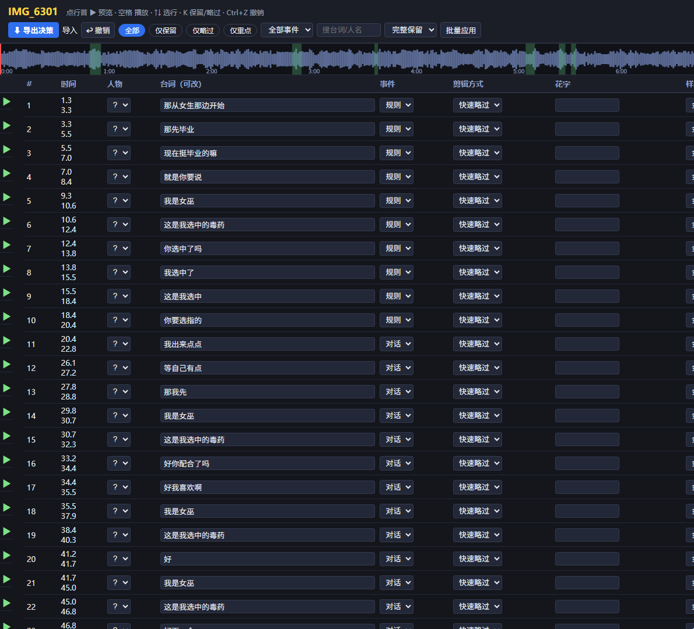
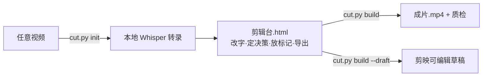

# 🎬 Subtitle Cut Studio · 字幕剪辑台

> **看着字幕剪视频**：任意视频 → 本地转录 → 文字剪辑台（点句预览/改字/定决策）→ 一键渲染成片 + 可选剪映草稿同步

不拖时间线、不逐帧找点——**像改文档一样剪视频**。每句台词一行：保留 / 略过 / 重点（自动花字）/ 慢放；点行即跳转视频预览；导出决策后一条命令出 1080p 成片。全程本地运行，视频不上传。



*剪辑台界面：全片台词决策表 + 声波时间轴（绿色为保留区），右侧视频预览与人物标记*

## ✨ 特性

- 📝 **文字即时间线** — faster-whisper 本地转录，每句一行：改错字、标说话人、定事件、选剪辑方式
- ▶️ **点行预览** — 行内视频跳转播放该句；**成片模式**播放时自动跳过被剪部分，直接预览成片效果
- 🎚️ **声波时间轴** — 逐秒响度剖面可视化，笑点/惊呼峰值一眼可见；高潮附近自动预填"保留"
- 🏷️ **四种剪辑方式** — 完整保留 / 快速略过 / 重点突出（弹入花字，金银蓝三色）/ 慢放突出（0.5x，音频同步变速）
- 🔊 **事件音效** — 安全/中毒时刻自动"叮/咚"提示音 + 花字弹出，逐行可控
- 🎯 **人物与标记** — 界面上添加人物（自动配色），在参考帧上点头顶放人名条、点物品放归属环，全程同色对应
- 📤 **自带渲染器** — 纯 ffmpeg：切片→拼接→ASS 字幕/花字（含弹入动画）→标记叠加→音效混音→自动质检
- 🎬 **剪映草稿同步**（可选）— 切割/变速/字幕/花字/人名条全部生成为可编辑剪映轨道
- 🔒 **全本地** — 转录、分析、渲染、决策都在你的机器上

## 🚀 快速开始

**依赖**：Windows / macOS / Linux，Python 3.10+，ffmpeg（含 libx264/aac/libass）在 PATH

```bash
pip install -r requirements.txt        # faster-whisper / opencc / pillow
python cut.py init 你的视频.mp4         # 转录+分析+生成剪辑台（首次跑会下载模型）
```

`init` 完成后当前目录会出现：

| 文件 | 说明 |
|---|---|
| `剪辑台.html` | 双击打开，做剪辑决策（浏览器本地运行，进度自动保存） |
| `witch_decisions.json` | 初始决策数据（剪辑台导出会覆盖它） |
| `预览视频.mp4` | 低码率代理，供剪辑台内嵌预览 |

在剪辑台里改完 → 点 **⬇ 导出决策** → 然后：

```bash
python cut.py build        # 渲染成片.mp4 + 自动质检；--draft 可同时同步剪映草稿
```

> 想让预填更聪明？`init --prefill all|peaks|none`（默认 peaks：响度高潮附近保留，其余略过）

## 🔄 工作流



## 📁 目录结构

```
cut.py                 # CLI 入口：init / build / draft
subcut/
├── asr.py             # 抽音频 + faster-whisper（CPU int8）+ 简繁统一
├── analysis.py        # 逐秒响度、参考帧网格、预览代理、台词决策预填
├── editor.py          # 单文件 HTML 剪辑台生成器（数据/声波/参考图内嵌）
├── timeline.py        # 决策→计划：窗口合并/慢放拆分/字幕花字重叠收敛/音效床/标记贴图
├── render.py          # 自带 ffmpeg 渲染器 + 质检
└── jianying.py        # 可选：pyJianYingDraft 剪映草稿同步
```

## 🛠️ 常见问题

见 [docs/FAQ.md](docs/FAQ.md)：ffmpeg 安装、ASS 字幕字体、剪映草稿占用/加密兼容、成片时长有小幅偏差的原因。

## 🔒 隐私

转录文本与参考帧含真实人物信息，注意不要把 `witch_decisions.json` / `out/` / 视频误提交到公开仓库（.gitignore 已默认排除）。

## 📄 License

MIT
